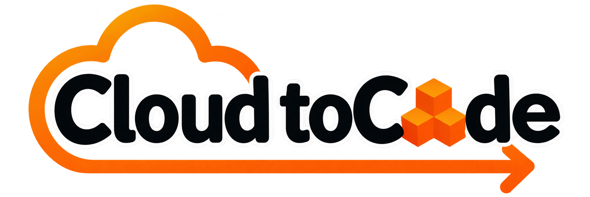
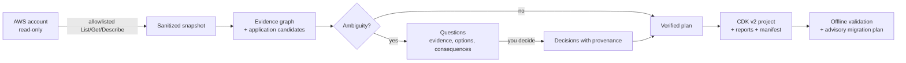

<p align="center">
  
</p>

<p align="center">
  <a href="https://github.com/Alejo2075/cloud-to-code/actions/workflows/ci.yml"></a>
  <a href="LICENSE"></a>
  
  
  
  
  
  
  
  <a href="CONTRIBUTING.md"></a>
  <a href="https://www.conventionalcommits.org"></a>
  <a href="https://developercertificate.org/"></a>
  <a href="https://github.com/Alejo2075/cloud-to-code/stargazers"></a>
  <a href="https://github.com/Alejo2075/cloud-to-code/commits/main"></a>
</p>

<h3 align="center">Turn running AWS infrastructure into code you can understand, review and own.</h3>

<p align="center">
  <a href="#quick-start">Quick start</a> ·
  <a href="#how-it-works">How it works</a> ·
  <a href="#safety-and-privacy">Safety</a> ·
  <a href="#use-it-with-ai-agents">AI agents</a> ·
  <a href="#supported-aws-services">Supported services</a> ·
  <a href="docs/README.md">Docs</a> ·
  <a href="CONTRIBUTING.md">Contributing</a>
</p>

---

**CloudtoCode** reverse-engineers an existing AWS application into a maintainable **AWS CDK v2 (TypeScript)** project. It reads your infrastructure **read-only**, reconstructs how the pieces fit together, **asks you the questions the evidence cannot answer**, and generates reviewable code together with an honest report of everything it could not recover.

It runs entirely on your machine: no hosted service, no account, no telemetry, and it never deploys, imports or deletes anything.

## Highlights

- **Understands applications, not just resource lists.** Finds application boundaries, shared resources and who triggers whom, with a confidence level (`confirmed`, `derived`, `hypothesis`) on every relationship.
- **Asks instead of guessing.** Ownership of a shared event bus, where Lambda source lives, what to do with stateful resources: each question comes with evidence, options, consequences and a safe recommendation. "I don't know" on a blocking question stops the run.
- **Maintainable CDK.** L2 constructs organized by role, tests that assert what was observed, and a provenance manifest linking every resource to AWS evidence, a mapping rule and your decisions.
- **Honest by design.** A coverage report marks every property as preserved, approximated, intentionally omitted, not mapped or unresolved. "`cdk synth` passed" is never presented as "safe to migrate".
- **Read-only on AWS, by construction.** A fixed allowlist of `List`/`Get`/`Describe` calls and a generated least-privilege IAM policy. No code, data, secrets or environment values are stored.
- **Works where you work.** Standalone CLI, a local MCP server and plugins for Claude Code and Codex. Same engine, same results.
- **Deterministic and offline-capable.** Same inputs and decisions produce byte-identical output. The demo, inspection, planning and generation need no network and no AI.

## Quick start

Requirements: **Node.js 22+** and **pnpm 9**.

```bash
git clone https://github.com/Alejo2075/cloud-to-code && cd cloud-to-code
pnpm install && pnpm build
alias c2c="node $PWD/apps/cli/dist/bin.js"
```

### Try the bundled example (no AWS, no AI, no network)

```bash
c2c demo
c2c reconstruct orders-api --demo                    # answer the questions in your terminal
# or non-interactively:
c2c reconstruct orders-api --demo \
  --answers examples/serverless-orders/answers.json --output ./orders-api
cd orders-api && npm install && npm test && npx cdk synth
```

The interview looks like this:

```text
[1/3] BLOCKING  Who should own 'shared-events'?
  Found:          'shared-events' (AWS::Events::EventBus) is connected to 2 application candidates
                  (orders-api, billing-handler) through: billing-invoice, orders-created.
  Uncertain:      AWS does not record which application owns a shared resource.
  Why it matters: The generated stack either manages this resource (and may collide with the existing
                  one) or only references it.
  If skipped:     Generation is blocked: an unanswered or "I don't know" answer stops the session.
  Options:        reference [recommended] | include in orders-api | include in billing-handler | exclude
```

and ends with a verified plan, the generated project and honest local checks:

```text
Generated 20 files in ./orders-api
Unresolved items needing manual work: 5 (see reports/coverage.json)
  [PASS] Manifest integrity: 19 files match the generated hashes.
  [WARN] Coverage: 95 preserved, 2 approximated, 13 intentionally omitted, 0 not mapped; 5 manual item(s).
Synthesis does not prove the template is equivalent to your running infrastructure or safe to import.
```

The committed result lives in [`examples/serverless-orders/expected`](examples/serverless-orders/expected/orders-api) and is verified byte for byte by the test suite.

### Reconstruct your own application

```bash
aws sso login --profile dev                       # any normal AWS credentials work
c2c init --profile dev --regions us-east-1
c2c discover --account 123456789012               # STS identity must match; metadata only
c2c reconstruct <application> --snapshot c2c-snapshot.json --output ./app-cdk
c2c validate ./app-cdk                            # offline checks; add --synth to also synthesize
c2c adoption plan ./app-cdk                       # advisory; never applies anything
```

Grant only the [generated least-privilege policy](docs/least-privilege-policy.json), and scan only the services you need with `--services`. More in the [quickstart](docs/quickstart.md) and the [CLI reference](docs/cli.md).

## How it works



1. **Discover** (deterministic): scoped, read-only, sanitized before anything is stored.
2. **Analyze** (deterministic): ARN joining, deduplication, confidence levels, shared-resource detection.
3. **Interview**: questions arise only from real uncertainty, at most three per batch; answers are validated and recorded; changed evidence reopens a question.
4. **Plan**: a deterministic planner (or a plan proposed by an agent or model) must pass the verifier before it can be used.
5. **Generate and validate**: deterministic generation, then structure, hash, coverage, typecheck and (optionally) synth checks.

See the [architecture](docs/architecture.md) and the [interaction model](docs/interaction-model.md).

## Why not `cdk migrate` or the CloudFormation IaC Generator?

Those tools turn a list of resources into a template. CloudtoCode goes further:

|                                                                          | Resource-list tools              | CloudtoCode                                                 |
| ------------------------------------------------------------------------ | -------------------------------- | ----------------------------------------------------------- |
| Understands the **application** (boundaries, shared resources, triggers) | no                               | yes, with confidence per relationship                       |
| Output                                                                   | template or mostly L1 constructs | stacks and **L2 constructs** organized by role, with tests  |
| When something is ambiguous                                              | guesses                          | **asks you**, with evidence, options and consequences       |
| Explains itself                                                          | no                               | every resource links to evidence, a rule and your decisions |
| Safety messaging                                                         | --                               | synth is never presented as equivalence or safe adoption    |
| Works with your AI agent                                                 | no                               | local MCP server + Claude Code and Codex plugins            |

## Safety and privacy

| Guarantee                         | How it is enforced                                                                                                                                                                            |
| --------------------------------- | --------------------------------------------------------------------------------------------------------------------------------------------------------------------------------------------- |
| AWS is read-only                  | SDK command allowlist; a test proves collectors can reach nothing else; the IAM policy is generated from the same list; the MCP server has no deploy, import, delete or shell tool            |
| No secrets or private data stored | Sanitization before persistence, prompts, MCP responses and reports; canary-secret regression tests; code, S3 objects, DynamoDB items, queue messages and environment values are never stored |
| You stay in control               | Blocking questions stop the run; generated code goes to a new directory; overwriting needs an explicit flag                                                                                   |
| Facts are not guesses             | Observed, derived, hypothesis and user-decided data are kept apart; an IAM permission is never treated as proof of use                                                                        |
| Untrusted input stays untrusted   | Tags, names and model output are data, never instructions; models have no tool authority; plans from models or agents must pass a deterministic verifier                                      |
| External models need consent      | Previewable payload, consent bound to provider, endpoint and the exact data digest, a `never` policy, and local endpoints exempt                                                              |

Read the full [security and privacy model](docs/security.md), including what is **not** guaranteed, and report vulnerabilities privately per [SECURITY.md](SECURITY.md).

## Use it with AI agents

A local stdio MCP server (`@cloud-to-code/mcp`, nine tools) and thin plugins let Claude Code, Codex or any MCP client drive the same engine and ask you the questions in their own chat. The host's model does the talking; CloudtoCode never calls another model on its behalf.

| Tool                                                                  | Purpose                                                      |
| --------------------------------------------------------------------- | ------------------------------------------------------------ |
| `aws_discover`                                                        | Read scoped metadata into a sanitized snapshot               |
| `inspect_application`                                                 | Graph, candidates, confidence, diagnostics                   |
| `start_reconstruction` · `get_pending_questions` · `submit_decisions` | Resumable, question-driven session                           |
| `submit_reconstruction_plan`                                          | Verify an agent-proposed plan (or use the deterministic one) |
| `generate_cdk` · `validate_cdk` · `get_migration_plan`                | Generate, validate and get advisory migration analysis       |

Setup for Claude Code, Codex and MCP-only clients: [docs/plugins.md](docs/plugins.md).

## Supported AWS services

| Service               | Discovery | CDK generation                                  |
| --------------------- | :-------: | ----------------------------------------------- |
| Lambda (zip)          |    yes    | L2 `Function`, event sources, layers            |
| API Gateway HTTP APIs |    yes    | L2 `HttpApi`, Lambda proxy routes, CORS, stages |
| DynamoDB              |    yes    | L2 `Table`, GSIs/LSIs, streams, PITR, TTL       |
| SQS                   |    yes    | L2 `Queue`, DLQ/redrive, FIFO, SSE              |
| EventBridge           |    yes    | L2 `EventBus`, `Rule`, Lambda and SQS targets   |
| S3 (metadata only)    |    yes    | L2 `Bucket`, Lambda notifications               |
| IAM roles             |    yes    | L2 `Role`, policies preserved verbatim          |

The detailed matrix, including what is reported as unresolved, is in [docs/resource-support.md](docs/resource-support.md).

## Command overview

| Command                                             | Purpose                                                            |
| --------------------------------------------------- | ------------------------------------------------------------------ |
| `c2c demo`                                          | Explore the bundled example offline                                |
| `c2c init` · `c2c config show`                      | Non-secret defaults (no credentials are stored)                    |
| `c2c discover`                                      | Read-only discovery of an explicit account, regions and services   |
| `c2c inspect`                                       | Topology, evidence, uncertainty, optional Mermaid diagram          |
| `c2c reconstruct`                                   | Question-driven plan and generation                                |
| `c2c questions` · `answer` · `resume` · `decisions` | Resumable interview with an audit trail                            |
| `c2c generate` · `validate` · `adoption plan`       | Generate, check, and plan adoption (advisory)                      |
| `c2c ai connect` · `ai test` · `ai preview`         | Optional AI provider, with a preview of exactly what would be sent |

`--json` and `--non-interactive` make every command scriptable: a blocking question returns exit code `10` and structured questions instead of hanging. Full reference: [docs/cli.md](docs/cli.md).

## Project layout

```text
apps/cli                  c2c command-line interface
packages/core             versioned schemas, evidence graph, sanitization (no AWS/MCP/model SDKs)
packages/reconstruction   questions, decisions, sessions, planner, plan verifier
packages/provider-aws     read-only collectors, allowlist, snapshot assembly
packages/generator-cdk    deterministic CDK v2 generation
packages/validator        offline validation and advisory adoption plan
packages/mcp              local stdio MCP server
packages/ai               optional, consent-gated model providers
packages/diagram-mermaid  diagrams generated from the graph
plugins/                  Claude Code and Codex plugins (skills + manifests)
examples/                 sanitized example with verified expected output
docs/                     architecture, security, CLI, ADRs
```

## Known limitations

CloudtoCode is explicit about its edges rather than hiding them:

- **Scope.** It reconstructs the services listed above. Everything else (VPC, RDS, ECS/EKS, Cognito, Step Functions, CloudFront, ...) is excluded explicitly and reported, never dropped silently. REST and WebSocket APIs, container-image Lambdas, authorizers and VPC-attached functions are reported as unresolved.
- **Not recoverable from AWS.** Application source code, environment values and data are never collected. Generated stacks take Lambda code and environment values from CloudFormation parameters.
- **Strategies.** `balanced` generation and `recreate`/`reference` ownership are implemented; `faithful`, `modernized` and automatic `adopt` are not (adoption is advisory only).
- **Equivalence is not proven.** Passing tests and `cdk synth` show that the code builds and reproduces the observed properties listed in `coverage.json`, not that it matches the running system. Stateful and shared resources always need human review.
- **Verification so far.** The AWS collectors and AI adapters are covered by tests against in-memory fakes with SDK-shaped responses; reports from real accounts are very welcome. Linux CI covers Node 22 and 24.

The up-to-date list lives in [docs/roadmap.md](docs/roadmap.md).

## Documentation

[Quickstart](docs/quickstart.md) · [CLI](docs/cli.md) · [Architecture](docs/architecture.md) · [Interaction model](docs/interaction-model.md) · [Security](docs/security.md) · [Migration semantics](docs/migration-semantics.md) · [Resource support](docs/resource-support.md) · [Plugins and MCP](docs/plugins.md) · [Roadmap](docs/roadmap.md) · [ADRs](docs/adr/)

## Contributing

Contributions are welcome. New service collectors, relationship resolvers, fixtures and CDK mapping rules are small, well-bounded pieces with a test pattern to copy; see [good first issues](docs/good-first-issues.md).

```bash
pnpm install && pnpm check      # lint + typecheck + tests; no AWS account or AI key needed
```

Read [CONTRIBUTING.md](CONTRIBUTING.md) (DCO sign-off, Conventional Commits) and the [Code of Conduct](CODE_OF_CONDUCT.md). Governance is described in [GOVERNANCE.md](GOVERNANCE.md).

## Security

Please report vulnerabilities privately through [GitHub security advisories](https://github.com/Alejo2075/cloud-to-code/security/advisories/new); see [SECURITY.md](SECURITY.md).

## License

Released under the [Apache License 2.0](LICENSE).
