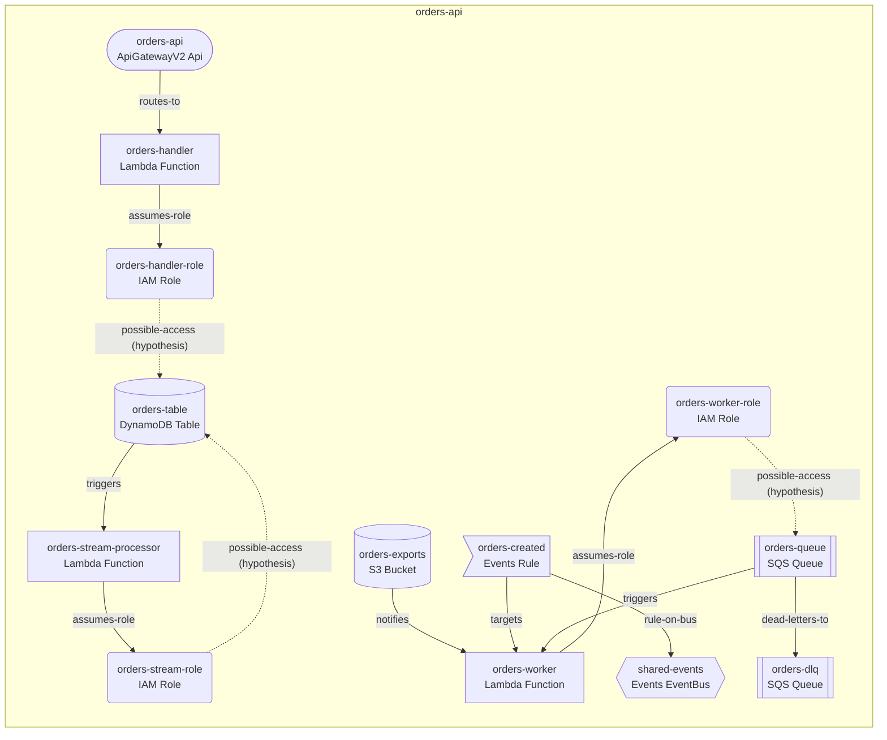

# Architecture: orders-api

Reconstructed from snapshot `snap-b993fa33cdb3f726` (collected 2026-01-15T12:00:00Z) using the **balanced** strategy. Plan produced by `deterministic-planner`.

> Every relationship below is labeled by confidence. Dotted edges are derived or **hypotheses** (for example an IAM permission is not proof of use).

## Diagram

## Resources

| Resource | Type | Ownership | Construct | Rule |
| --- | --- | --- | --- | --- |
| orders-handler-role | AWS::IAM::Role | recreate | OrdersApiCompute | compute/iam-role@1 |
| orders-stream-role | AWS::IAM::Role | recreate | OrdersApiCompute | compute/iam-role@1 |
| orders-worker-role | AWS::IAM::Role | recreate | OrdersApiCompute | compute/iam-role@1 |
| orders-exports | AWS::S3::Bucket | recreate | OrdersApiData | data/s3-bucket@1 |
| a1b2c3d4e5 | AWS::ApiGatewayV2::Api | recreate | OrdersApiApi | api/http-api@1 |
| orders-table | AWS::DynamoDB::Table | recreate | OrdersApiData | data/dynamodb-table@1 |
| shared-events | AWS::Events::EventBus | reference | OrdersApiReferences | reference/lookup@1 |
| shared-events/orders-created | AWS::Events::Rule | recreate | OrdersApiEvents | events/event-rule@1 |
| orders-handler | AWS::Lambda::Function | recreate | OrdersApiCompute | compute/lambda-function@1 |
| orders-stream-processor | AWS::Lambda::Function | recreate | OrdersApiCompute | compute/lambda-function@1 |
| orders-worker | AWS::Lambda::Function | recreate | OrdersApiCompute | compute/lambda-function@1 |
| orders-dlq | AWS::SQS::Queue | recreate | OrdersApiMessaging | messaging/sqs-queue@1 |
| orders-queue | AWS::SQS::Queue | recreate | OrdersApiMessaging | messaging/sqs-queue@1 |

## Excluded from this reconstruction

Nothing was excluded.

## What this report does not tell you

- It reflects only what the read-only discovery observed; missing permissions or skipped services are not evidence of absence.
- Application source code, environment values, data and secrets were never collected.
- `cdk synth` only proves the generated code produces a CloudFormation template. It does **not** prove the template is equivalent to the running infrastructure, that ownership is correct, or that anything can be safely imported or deployed.
